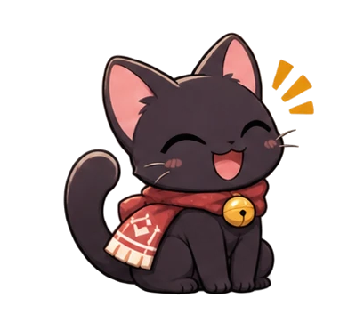
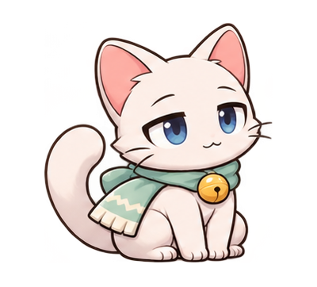

<div align="center">

 

# 묘수

**고양이와 두는 오목**

오목을 좋아하는 고양이 까망이, 하양이와 렌주 룰로 한 판.<br>
직접 학습시킨 작은 신경망이 브라우저 안에서 수를 읽습니다. 서버 없이요.

### [▶ 바로 두기 — myosu-mks.pages.dev](https://myosu-mks.pages.dev)

홈 화면에 설치하면 오프라인에서도 둘 수 있어요.

</div>

---

## 고양이 소개

| | 까망이 | 하양이 |
|---|---|---|
| 성격 | 신나고 우쭐하고 승부욕 강함 | 느긋하고 엉뚱하지만 은근히 지기 싫어함 |
| 난이도 | 보통: 한 수에 160번 읽고 항상 최선수 | 쉬움: 24번만 읽고 상위 후보 중에 고름 |
| 무르기 | 1번 | 3번 |

둘 다 같은 신경망을 씁니다. 하양이는 덜 읽고 가끔 2~4순위 수를 두지만, 자기 다섯과 상대 넷 막기는 절대 놓치지 않아요.
고양이는 필요한 순간에만 말합니다. 넷을 만들면 놀라고, 금수 자리를 누르면 말리고, 지면 분해해요.

## 할 수 있는 것

**대국** — 흑이나 백을 골라 둡니다. 흑의 금수(3·3, 4·4, 장목)를 판정해서 알려 줘요. 화면에는 고양이의 말과 형세 그래프만 있어요.

**훈수** — 막히면 다른 고양이가 판 구석에 와서 *한 수 추천*이나 *필승 수*를 한 번씩 알려 줍니다. 상대 고양이는 그걸 듣고 삐져요.

**복기** — 끝난 판을 열면 고양이가 승부처를 짚어 줍니다. 추측은 보여 주지 않아요.
- *놓친 필승*: 넷으로 이기는 수순이 있었는데 놓친 수. 수순을 끝까지 탐색해서 확인합니다.
- *판이 넘어간 수*: 엔진이 다시 읽었을 때, 최선수라면 팽팽했고 실제 둔 수 뒤로는 진 판인 수.
- 내 차례인 어느 수에서든 **그 자리부터 다시 두기**로 같은 고양이와 다시 겨룰 수 있어요.

**묘수풀이** — 넷을 이어 가며 이기는 문제 30개. 고양이가 막습니다.
- 넷 이어 가기 12 · 금수 함정 6 · 긴 수순 12
- 복기에서 놓친 필승은 *내 기보에서* 테마에 문제로 쌓여요.

## 어떻게 동작하나

```
학습 (로컬)                                    앱 (브라우저, 서버 없음)
자가대국 리그 → 리플레이 버퍼 → 학습              렌주 판정 · VCF 탐색
→ 챔피언과 40판으로 승급 판정        ──모델 1개──▶  신경망 + MCTS 수읽기
arch-bench/ (Python) + engine-rs/ (Rust)          고양이 대사 · 표정
```

- **신경망**: 15×15 판을 D4 대칭(회전·반전 8가지)으로 보는 패턴 기반 모델. 수 확률(정책), 형세(가치), 남은 수 예측의 세 갈래로 출력합니다.
- **수읽기**: 브라우저에서 신경망을 붙인 MCTS를 돌립니다. 넷이 이어지는 강제 수순(VCF)은 따로 정확히 탐색해요.
- **학습**: AlphaZero 방식의 자가대국. 현재 모델이 챔피언과 과거 세대들을 상대로 두고, 챔피언을 40판 중 55% 이상 이기면 새 챔피언이 됩니다.
  한동안 정체됐을 때는 학습률이 바닥에 붙고, 챔피언보다 약해져도 되돌리지 않던 것이 원인이었습니다. 이 둘을 고친 뒤 다시 꾸준히 승급하고 있어요.

## 직접 실행하기

```bash
npm install
npm run dev      # 개발 서버 (http://localhost:5173)
npm test         # 테스트 (vitest)
npm run build    # dist/ 에 앱과 모델 하나를 묶음
```

빌드는 학습 결과(`arch-bench/checkpoints/`)가 있으면 현재 챔피언을, 없으면 `models/`의 모델을 묶습니다.
세대를 지정하려면 `GOMOKU_DEPLOY_GEN=314 npm run build`.

묘수풀이 문제는 `npx vite-node scripts/gen-puzzles.ts`로 다시 만들 수 있어요. 규칙 AI끼리 둔 판에서 강제 승리 수순이 있는 장면을 골라 테마별로 나눕니다.

### 학습을 돌리려면

```bash
cd engine-rs && cargo build --release   # Rust MCTS 엔진
python arch-bench/train_az_daemon.py --resume --gens 100 --parallel 128 --deep-sims 240
```

> 신경망 학습에는 작성자의 별도 라이브러리 `rg`(Rust 자동미분, Metal 가속)가 필요해서, 지금은 이 저장소만으로 학습을 그대로 재현할 수 없습니다.

## 폴더 구조

| 경로 | 내용 |
|---|---|
| `src/engine/` | 렌주 규칙, VCF, 신경망·MCTS, 난이도, 복기 분석, 묘수풀이 |
| `src/ui/`, `src/main.ts`, `src/style.css` | 화면 (프레임워크 없는 TypeScript) |
| `src/assets/` | 까망이·하양이 스프라이트 12종씩 |
| `src/data/patchNotes.ts` | 앱 안의 "새 소식" |
| `models/` | 배포 중인 모델 (`gen_314.bin`) |
| `static/` | PWA 아이콘, manifest, service worker |
| `arch-bench/` | 학습 코드 (Python) |
| `engine-rs/` | 학습용 Rust MCTS |
| `docs/` | 캐릭터 설정 |

## 라이선스

- **코드**: [MIT](LICENSE). 자유롭게 쓰고 고쳐도 됩니다.
- **까망이·하양이 캐릭터와 그림**: 모든 권리 보유. 개인적으로 실행해 보는 건 괜찮지만, 다른 곳에 쓰거나 고쳐서 배포하려면 허락이 필요해요. 포크해서 공개할 때는 그림을 바꿔 주세요. → [src/assets/LICENSE.md](src/assets/LICENSE.md)
